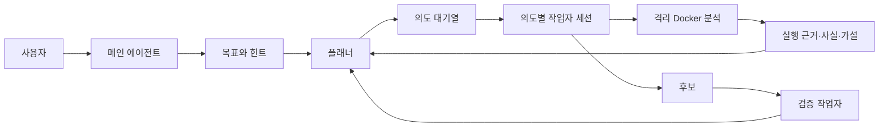

# Reverser v2: Artex형 작업 구조

## 목표

한 문제를 웹에서 실행하는 Solver 하나가 아니라, 문제마다 메인 에이전트·플래너·작업자·시스템 기록이 있는 작업 공간을 만든다. 화면의 세션과 탐색 그래프는 실제 에이전트 실행 및 근거 기록에서 생성한다.

현재 `web.py`의 `SolverManager`는 단일 Pi 프로세스를 시작하고 요약 이벤트만 보관한다. `solver.md`는 Solver가 의도까지 직접 만들도록 지시한다. 이 둘을 작업 오케스트레이터와 역할별 에이전트로 교체하는 것이 핵심이다.

## 역할과 권한

| 역할 | 한 문제에서 하는 일 | 만들 수 있는 기록 |
| --- | --- | --- |
| 메인 에이전트 | 사용자와 대화하고 목표·제약·힌트를 정리한다. 진행 상황을 설명하고 일시정지·재개를 요청한다. | 사용자 메시지, 목표, 힌트 |
| 플래너 | 새 문제, 작업자 결과, 사용자 힌트가 오면 현재 근거를 읽고 다음 분석 방향을 정한다. | 의도, 의도 간 연결, 계획 라운드 |
| 작업자 | 의도 하나만 맡아 파일을 분석한다. 각 도구 실행을 근거로 사실·가설·후보를 기록하고 결과를 반환한다. 새 의도는 만들지 않는다. | 도구 실행, 사실, 가설, 후보, 작업 결과 |
| 검증 작업자 | 후보가 나오면 깨끗한 Docker 작업자에서 재현하고 성공 분기를 확인한다. | 검증 실행, 검증 결과 |
| 시스템 | 상태 전환, 모델 변경, 오류, 취소·재시작을 기록한다. | 감사 이벤트 |

메인·플래너·각 의도 작업자는 별도 Pi 세션과 기록을 가진다. 기존 Pi 로그인과 API 키 선택은 모든 역할에 공통 적용하고, 역할별 모델 선택은 나중에 추가할 수 있게 둔다.

## 실행 흐름

1. 파일 업로드 시 원본을 비공개 `runs/`에 저장한다. 풀이 시작을 누르면 기본 triage를 실행하고 시스템이 최초 목표를 기록한 뒤 플래너를 깨운다.
2. 플래너만 실행 가능한 작은 의도를 만든다. 예: 입력 검증 함수 찾기, 특정 루프 역산, 후보를 정방향 실행으로 확인하기.
3. 오케스트레이터가 선행 의도가 완료된 열린 의도를 원자적으로 한 작업자에게 배정한다. 현재 `progress.md` 갱신 충돌을 피하려고 한 문제에서 한 작업자만 동시에 실행한다.
4. 작업자는 의도별 작업 폴더에서 분석하고 `evidence_run`이 있는 사실을 남긴다. 종료·막힘·예산 소진 결과가 플래너의 다음 라운드를 일으킨다.
5. 후보는 검증 작업자가 별도 실행으로 확인한다. 검증 근거가 있어야 목표를 완료한다. 실제 플래그는 비공개로 보관하며 자동 제출하지 않는다.

## 상태와 기록

- 작업 상태: `ready → running ↔ paused → verifying → solved | local_verified | unsolved | failed`.
- 의도 상태: `open → running → done | blocked | exhausted | stopped`. 중단 뒤에는 같은 의도와 세션을 재개할 수 있다.
- 그래프 노드: 시작점, 목표, 의도, 사실, 가설, 후보, 검증 결과. 간선: 생성, 파생, 산출, 지지, 반증, 검증.
- 사실은 `observed/inferred`, 근거 실행 ID, 연결 의도를 가진다. 근거 실행이 없는 사실은 등록하지 않는다.
- 활동 이벤트는 `seq, task_id, session_id, role, intent_id, kind, summary, detail_ref, time, token_usage`를 기록한다. 브라우저는 기록을 페이지로 읽고 SSE 커서로 새 이벤트를 받는다. 재접속 시 빠진 이벤트를 다시 읽는다.

SQLite를 Docker 상태 볼륨에 두고 작업·의도 배정·후보·활동 이벤트를 저장한다. 기존 `runs/`의 원본, 근거 실행, 사실·가설과 `progress.md`는 유지하고 탐색 그래프에서 함께 읽는다. 기존 문제는 새 풀이를 시작할 때 의도 상태를 SQLite에 동기화한다.

## 웹 화면

- 왼쪽 세션 목록: 메인 에이전트 세션, 플래너, 시스템 감사, 의도별 작업자. 작업자 행에 상태와 의도 번호를 표시한다.
- 세션 본문: 사용자 메시지, 계획 라운드, 작업자 목표, 도구 호출·결과, 근거 사실, 토큰 사용량을 시간순으로 보여준다. 메인 세션에서 지시를 보내고, 작업자 세션에서 해당 의도만 본다.
- 상단 탭: 세션, 개요, 탐색 경로, 근거 실행, 후보 검증, 자료.
- 탐색 경로: 실제 저장된 노드와 간선을 표시한다. 노드를 선택하면 근거 실행·파일·연관 세션으로 이동한다. 플래너가 만든 의도와 작업자가 남긴 사실의 작성 주체를 구분한다.
- 제어: 작업 전체 일시정지·재개, 메인 세션의 사용자 힌트 추가. 화면은 서버의 실제 상태를 따른다.

## 실행 경계

Pi 내장 파일·셸 도구 대신 문제 폴더로 경로를 강제하는 전용 도구를 역할별로 제공한다. 플래너는 그래프 읽기와 의도 작성 도구를, 작업자는 문제 파일 읽기·의도별 파일 쓰기·`reverser_exec`·근거 작성 도구를 받는다. 바이너리 명령은 지금처럼 네트워크 없는 일회용 Docker 작업자에서 실행한다. 원본은 읽기 전용, 작업 파일은 의도별로 분리한다. 활성 문제의 공개 write-up 검색은 허용하지 않는다.

## 구현 순서와 완료 기준

1. 활동 이벤트와 그래프 저장소를 만들고 기존 기록을 읽기 전용으로 연결한다.
2. 단일 `SolverManager`를 플래너 깨우기·의도 배정·작업자 완료 처리로 바꾼다. Pi 세션을 의도 ID로 지속 저장하고 재시작 복구를 넣는다.
3. 세션 목록·실시간 이력·탐색 그래프를 실제 이벤트 API에 연결한다.
4. 후보 검증 작업자, 일시정지·재개, 근거 연결 검사를 붙인다.

완료 판정: 새 문제 하나에서 플래너가 의도를 만들고, 작업자가 독립 세션에서 하나를 수행하며, 근거 사실이 그래프와 세션 양쪽에 즉시 나타난다. 재시작 후 세션·의도 상태가 유지되고, 검증 실행 없이는 해결로 표시되지 않는다.
